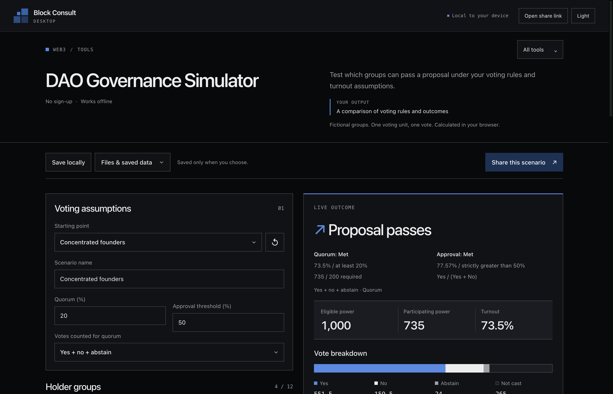
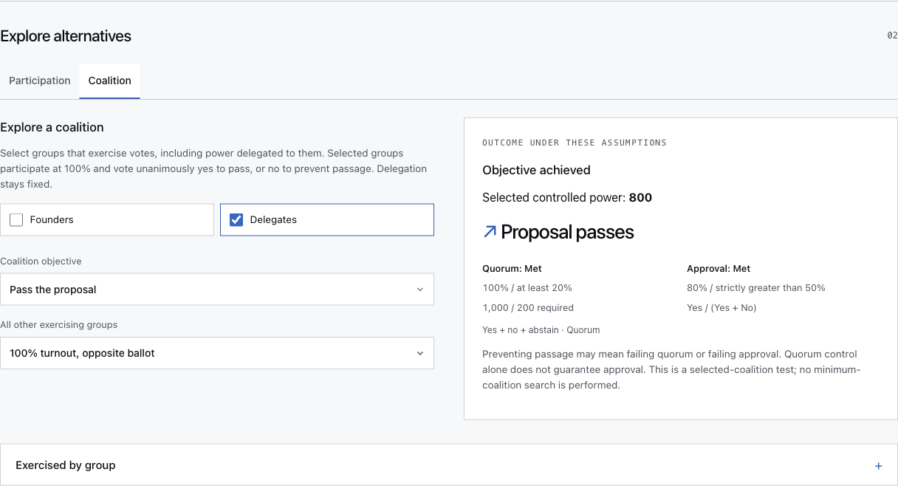

<a href="https://www.blockconsult.org">
  <picture>
    <source media="(prefers-color-scheme: dark)" srcset="public/blockconsult-logo.png">
    
  </picture>
</a>

# DAO Governance Simulator

Test whether a proposal passes under a DAO's voting rules and assumed turnout. Enter holder groups, voting power, ballot preferences and delegation, then compare quorum, approval, concentration and selected-coalition outcomes.

A local planning tool from [Block Consult](https://www.blockconsult.org), available for macOS, Windows and the browser in English and German. Calculations run on your device without an account or API key.

[](https://github.com/blockconsult-org/dao-governance/releases/latest) [](LICENSE) · [Platform builds](https://github.com/blockconsult-org/dao-governance/actions/workflows/release.yml)

**[Download for macOS or Windows](https://github.com/blockconsult-org/dao-governance/releases/latest)** · [Use in your browser](https://www.blockconsult.org/tools/dao-governance) · [Report an issue](https://github.com/blockconsult-org/dao-governance/issues)



The desktop workspace keeps the voting assumptions beside the calculated outcome.

## What you can do

- Model up to 12 holder groups with separate voting power, participation and yes/no/abstain splits.
- Change quorum and approval thresholds, including whether abstentions count toward quorum.
- Delegate a group's power to another direct-voting group and inspect where control sits before and after delegation.
- Keep a baseline while editing a scenario, sweep participation from 0% to 100%, or test a selected coalition against different assumptions about other groups.
- Export a JSON model, PNG summary or PDF discussion sheet, or create a share link with a preview of the included data.

The model uses one voting unit per vote and one-hop delegation. It does not predict individual behavior or search for the smallest winning coalition. Quorum uses an inclusive threshold; approval must be strictly greater than the selected threshold.

## Get started

1. Choose a **Starting point**, such as **Delegate-led participation**.
2. Set the voting rules and edit the **Holder groups**. Review the **Live outcome** as the assumptions change.
3. Open **Baseline / scenario** to keep a comparison, then use **Explore alternatives** to test participation or a coalition.
4. Choose **Save locally** to retain the scenario, or use **Files & saved data → Export JSON** for a portable copy.

## Screenshots



The fictional **Delegate-led participation** example, with Delegates selected to pass a proposal while all other exercising groups vote against it. The result follows the displayed assumptions; it is not a prediction of a real vote.

## Download and install

| Platform | Download | Installation |
| --- | --- | --- |
| macOS, Apple silicon and Intel | Universal `.dmg` | Open the disk image and drag the app to Applications. |
| Windows 11, Intel/AMD 64-bit | `windows-x64-setup.exe` | Run the per-user installer; administrator rights are not required. |
| Windows, portable | `windows-x64-portable.exe` | Run directly without installing. |

Release notes state the signing and notarization status of each download. Unsigned Windows releases may show a publisher warning. macOS requires macOS 13 or later. Check `SHA256SUMS.txt` against the downloaded file using `shasum -a 256` (macOS) or `Get-FileHash -Algorithm SHA256` (PowerShell). Download only from this repository's Releases page.

## Your data

- Calculations and editing work without an internet connection, account or API key.
- English/German UI, light/dark themes, keyboard controls and resizable layouts.
- Existing JSON models and browser share links remain compatible. Use **Open share link** to inspect a shared scenario locally.
- Exports use a native file-save dialog. **File → Save report as PDF** writes a local PDF.
- **Save locally** stores the current scenario and baseline in this app's local profile. Later edits are not saved automatically. JSON exports are portable backups.
- No analytics, telemetry, cloud synchronization or automatic uploads. Website and evidence links open in your default browser. Unknown evidence destinations require confirmation.

Share links are readable, encoded snapshots, **not encrypted**. They include the baseline and scenario; names, titles and discussion notes are excluded unless you select them in the sharing preview. Opening a link shows a read-only snapshot without changing the local save. Choose **Make a copy** to edit it. Save or export before closing the app or opening a share link; unsaved edits can be lost.

## Run from source

Install Node.js 24 or newer, then:

```sh
git clone https://github.com/blockconsult-org/dao-governance.git
cd dao-governance
npm ci
npm run build
npm start
```

`npm run dev` runs the renderer in a browser. `npm test` checks the model and desktop security boundaries. `npm run test:desktop` launches real Electron and exercises offline rendering, themes, localization, exports and isolation. Run `npm run build` first.

```sh
npm run verify
npm run dist -- --mac --universal  # on macOS
npm run dist -- --win --x64       # on Windows
```

## Project layout

| Path | Responsibility |
| --- | --- |
| `tools/dao-governance/` | Models, calculations, localized copy, UI and exports |
| `src/` | Desktop frame and small browser-framework adapters |
| `desktop/` | Sandboxed Electron host, local asset protocol, native PDF saving |
| `tests/` | Calculation regressions and real desktop integration checks |
| `.github/workflows/release.yml` | Tests and platform builds; draft releases for version tags |

## Release and maintenance

See the [release instructions](docs/RELEASING.md) for packaging and signing. Releases are manual downloads; the app does not silently update. Keep the Electron runtime current when maintaining a fork.

This tool supports governance planning and discussion. Results depend on the supplied assumptions; real governance systems may use different voting and delegation rules.

## Contributing and license

Read the [contribution guide](CONTRIBUTING.md) before opening a pull request. Report vulnerabilities through the process in the [security policy](SECURITY.md).

[MIT](LICENSE) · Copyright © 2026 Block Consult GmbH. The license covers the code; it does not grant rights to use Block Consult’s name or logo as an endorsement.
